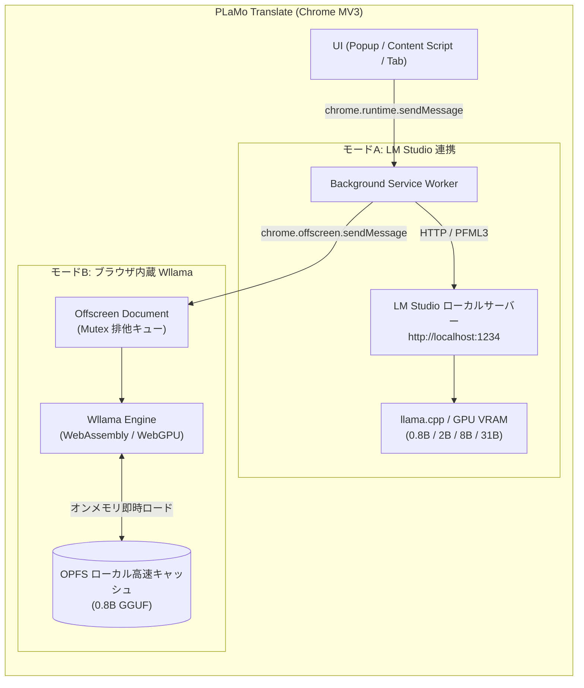

# PLaMo Translate (LM Studio & ブラウザ内蔵 Wllama)

[English](README.en.md) | 日本語

Preferred Networks (PFN) がオープンウェイトとして公開した、世界最高水準の翻訳特化型大規模言語モデル **「PLaMo 3 Translate」ファミリー（0.8B / 2B / 8B / 31B）** を、ブラウザから直接利用できる Chrome 拡張機能 (Manifest V3 / Vanilla JS) です。

外部の有償クラウド翻訳 API（Google Cloud Translation, DeepL 等）へのデータ送信を一切行わず、**完全ローカル環境で機密データや社内ドキュメントを安全・高速・無制限に翻訳**できます。

---

## デュアル推論エンジン構成 (Dual Inference Engine)

本拡張機能は、利用シーンや PC スペックに応じて柔軟に使い分けられる **2 つのローカル推論エンジン** を搭載しています。ポップアップの切替タブや設定画面からいつでもワンクリックで切り替え可能です。



| 項目 | モードA: LM Studio ローカルサーバー接続 | モードB: ブラウザ内蔵 Wllama 推論 |
| :--- | :--- | :--- |
| **動作形態** | 外部デスクトップアプリ（LM Studio）と HTTP 通信 | **Chrome 拡張機能単体で完結**（Offscreen Document） |
| **追加アプリ** | **必要**（LM Studio を起動） | **不要**（ブラウザだけで動作） |
| **対応モデル** | **0.8B / 2B / 8B / 31B 全モデル**<br>（各種 GGUF / FP16） | **PLaMo 3 Translate 0.8B**<br>（公式 GGUF 量子化各種） |
| **ハードウェア** | LM Studio の GPU オフロード（NVIDIA / Apple Silicon 等） | **WebGPU** 加速対応（非対応環境は WASM CPU へ自動フォールバック） |
| **モデル保存** | LM Studio のローカルストレージ | **OPFS (Origin Private File System)** に永続キャッシュ |
| **こんな時におすすめ** | 2B / 8B / 31B の最高品質な長文・専門翻訳を行いたい時 | 追加ソフトを導入せず、手軽にブラウザ単体で即時翻訳したい時 |

---

## PLaMo 3 Translate モデルファミリー

PFN から公開されている全モデルサイズ、および各種量子化 GGUF（`Q4_K_M`, `Q4_0`, `Q8_0` 等）に対応しています。

| モデルサイズ | パラメータ数 | 推論モード | 特徴とおすすめ環境 |
| :--- | :--- | :--- | :--- |
| **PLaMo 3 Translate 0.8B** | 8億 | **モードA / モードB 両対応** | **超軽量・超高速**。ブラウザ内蔵 Wllama でも軽快に動作し、一般的な CPU/GPU でも即座に応答。日常の Web 閲覧に最適。 |
| **PLaMo 3 Translate 2B** | 20億 | モードA (LM Studio) | **速度と精度のベストバランス**。一般的な GPU 環境で高速に高品質な翻訳を実現。 |
| **PLaMo 3 Translate 8B** | 80億 | モードA (LM Studio) | **高精度・表現力重視**。複雑な複文や長文、専門的な文脈を正確に反映（VRAM 8GB〜16GB 推奨）。 |
| **PLaMo 3 Translate 31B** | 310億 | モードA (LM Studio) | **最高峰の翻訳品質**。大規模 GPU サーバーや高性能ワークステーション向け。 |

※ 全モデル共通で **PFML3 プロンプト仕様**、**53言語相互翻訳**、**日本語の敬体/常体制御**、**コンテキスト・用語集（Glossary）指定** に完全対応しています。

### モードB 搭載 GGUF プリセット (`pfnet/plamo-3-translate-0.8b-GGUF`)

拡張機能の設定画面からワンクリックで選択・ロードできます：

1. **Q4_K_M** (約547MB) - **推奨デフォルト**。翻訳精度と推論速度のベストバランス。
2. **Q4_0** (約522MB) - 標準的な4ビット量子化。
3. **Q3_K_M** (約464MB) - 軽量化版。メモリ使用量を抑えたい環境向け。
4. **Q2_K** (約391MB) - 超軽量版。ダウンロードサイズ・消費メモリ最小。
*(カスタム Hugging Face resolve URL の入力にも対応)*

---

## 主な特徴

1. **PFML3 プロンプト完全準拠**:
   - PLaMo 3 Translate シリーズ共通の特殊タグフォーマット（`<|plamo:tag|>`, `<|plamo:msg|>`, `<|plamo:key|>`, `<|plamo:val|>`）を厳密に構築し、モデル本来の翻訳性能を最大限に引き出します。
2. **日本語の文体制御 (敬体 / 常体)**:
   - 日本語訳出力時に「丁寧語 (`polite`: です・ます調)」または「常体 (`plain`: だ・である調)」を明示的に指定可能。
3. **コンテキスト (Context) & 用語集 (Glossary) の指定**:
   - 専門分野の背景説明（Context）や、固有表現・社内用語・製品名（Glossary）の対訳ルールを指定可能。
4. **ブラウザ選択テキストのインライン翻訳**:
   - Web ページ上でテキストを選択すると、付近に浮遊ボタン（`🌐 PLaMo`）または即時カードが出現。
   - フォームやテキスト入力欄（`<input>`, `<textarea>`, `contenteditable`）内のテキストを選択した場合は、翻訳結果で「✍️ 置換」することも可能。
5. **Web ページ全体の段落インライン対訳翻訳**:
   - ページ内の段落・見出し・リストを自動収集し、**画面内（ビューポート）に見えている要素から優先翻訳**。
   - 原文の直下に対訳ブロックを挿入。
   - 画面右下のフローティング操作バーから「進捗確認」「一時停止/再開」「原文の非表示/表示」「元に戻す (完全復元)」が可能。
6. **スマート日英自動反転 (Auto Ja↔En)**:
   - 翻訳先が「日本語」の状態で日本語の文章を入力すると、自動的に「英語」への翻訳に切り替わります。
7. **オフスクリーン並行制御 & 排他キュー**:
   - モードB では Offscreen Document を活用し、複数段落の並行翻訳リクエストも KV キャッシュの衝突を防ぐ排他キュー（Mutex）により安定処理します。
8. **快適な UI (ポップアップ & 全画面タブ)**:
   - 通常のポップアップウィンドウに加え、「🗗 タブで開く」ボタンで専用タブの 2 カラム大画面翻訳ワークスペースとしても利用可能。

---

## サポート言語 (53 言語)

PLaMo 3 Translate が公式対応している 53 言語すべてに対応しています：

> **主要言語**: 日本語 (`ja`), 英語 (`en`), 中国語 (`zh`), 韓国語 (`ko`), フランス語 (`fr`), ドイツ語 (`de`), スペイン語 (`es`), イタリア語 (`it`), ロシア語 (`ru`), ベトナム語 (`vi`), タイ語 (`th`), インドネシア語 (`id`), アラビア語 (`ar`), オランダ語 (`nl`), ポーランド語 (`pl`), ポルトガル語 (`pt`), トルコ語 (`tr`), ヒンディー語 (`hi`), ウクライナ語 (`uk`) ほか全 53 言語。

---

## セットアップ手順

### 1. Chrome 拡張機能のインストール

1. Google Chrome を開き、アドレスバーに `chrome://extensions/` と入力して移動します。
2. 画面右上の「**デベロッパー モード**」のスイッチを **ON** にします。
3. 画面左上に現れる「**パッケージ化されていない拡張機能を読み込む**」ボタンをクリックします。
4. ダウンロードまたはクローンした本フォルダ（`PlaMo_translate`）を選択します。
5. ツールバーに「**PLaMo Translate**」のアイコンが表示されたらインストール完了です。ピン留めしておくと便利です。

---

### 2. 推論モードの選択と準備

#### 【モードB: ブラウザ内蔵推論を利用する場合 (推奨・最も簡単)】

外部ソフトのインストールは一切不要です：

1. 拡張機能アイコンをクリックし、上部の「**モードB: ブラウザ内蔵 (Wllama)**」タブを選択します。
2. 「**📥 モデルをロード**」ボタンをクリックします。
3. 初回のみ Hugging Face から GGUF モデル（約547MB）がダウンロードされ、ブラウザの高速ストレージ（OPFS）に安全にキャッシュされます（ダウンロード進捗バーが表示されます）。
4. ロード完了（Ready）と表示されたら、すぐに拡張機能内で高速翻訳が可能です！
※ WebGPU 対応ブラウザでは自動的に GPU アクセラレーションが有効化されます（非対応環境では CPU WASM で動作）。

#### 【モードA: LM Studio 接続を利用する場合 (2B / 8B / 31B モデル)】

大規模モデルを活用したい場合：

1. PC で [LM Studio](https://lmstudio.ai/) を起動します。
2. 検索バーでお好みの PLaMo モデル（`plamo-3-translate-2b`, `8b`, `31b` 等）を検索し、GGUF をダウンロードします。
3. 「**<->** (Local Server)」タブを開き、モデルをロードして「**Start Server**」（ポート: `1234`）をクリックします。
4. 拡張機能ポップアップの「**モードA: LM Studio 接続**」タブを選択し、「⚙️ 設定」の「🔌 接続テスト」を押すとモデルが自動認識されます。

---

## 使い方

### 1. ポップアップ翻訳

- 拡張機能アイコンをクリックし、原文を入力して `Ctrl + Enter`（または「翻訳する」ボタン）を押します。
- 右上の「🗗 タブで開く」ボタンを押すと、長文翻訳に適したワイドな 2 カラム画面に切り替わります。
- 「コンテキスト & 用語集」を開くことで、専門用語ルール（例: `LLM=大規模言語モデル`）を指定できます。

### 2. 選択テキストのインライン翻訳

- 閲覧中の Web ページ上でテキストをドラッグ選択します。
- 選択範囲の右下に現れる青い `🌐 PLaMo` アイコンをクリックすると、カード形式で即座に対訳が表示されます。
- 入力フォーム（SNS 投稿欄やテキストエリアなど）内で選択した場合は、「✍️ 置換」ボタンで選択テキストを翻訳文に直接置き換えることができます。

### 3. Web ページ全体の対訳翻訳

- 拡張機能ポップアップの「🌐 ページ全体を翻訳」をクリック、またはページ上を右クリックして「**PLaMo Translate でこのページを翻訳**」を選択します。
- ページ内の段落をスキャンし、**現在見えている画面（Viewport）から順番にインライン対訳ブロックを挿入**します。
- 画面右下の操作バーから「原文を隠す / 表示」「一時停止 / 再開」「元に戻す」が可能です。

---

## PFML3 プロンプト仕様

本拡張機能は、Preferred Networks の公式仕様に基づき以下の PFML3 構造を自動構築して推論エンジンへ渡します（モードA / モードB 共通）：

```text
<|plamo:tag|>dataset<|plamo:msg|>translation
<|plamo:tag|>context<|plamo:msg|>{コンテキスト}
<|plamo:tag|>glossary<|plamo:key|>{原文用語1}<|plamo:val|>{訳語1}<|plamo:key|>{原文用語2}<|plamo:val|>{訳語2}
<|plamo:tag|>input<|plamo:key|>lang<|plamo:val|>{翻訳元言語}<|plamo:msg|>{原文テキスト}
<|plamo:tag|>output<|plamo:key|>lang<|plamo:val|>{翻訳先言語}<|plamo:key|>form<|plamo:val|>{polite/plain}<|plamo:msg|>
```

### Stop Tokens (停止条件)

- `<|plamo:tag|>`
- `<|plamo:bos|>`
- `<|plamo:eos|>`
- `<|endoftext|>`

---

## 設定項目

拡張機能の「⚙️ 設定」アイコンから以下の調整が可能です：

| 項目 | デフォルト | 説明 |
| :--- | :--- | :--- |
| **推論エンジン** | `LM Studio (モードA)` | `LM Studio (モードA)` または `ブラウザ内蔵 Wllama (モードB)` |
| **UI 言語** | `自動` | インターフェース表示言語（`自動 (ブラウザ依存)` / `日本語` / `英語`） |
| **LM Studio サーバー URL** | `http://localhost:1234` | モードA 使用時の推論サーバー URL |
| **LM Studio 使用モデル** | 自動検出 | モードA で `/v1/models` から選択、または手動入力 |
| **LM Studio API モード** | `completions` (推奨) | `/v1/completions` または `/v1/chat/completions` |
| **Wllama プリセットモデル** | `Q4_K_M (約547MB)` | モードB 使用時の GGUF モデル（Q4_K_M / Q4_0 / Q3_K_M / Q2_K） |
| **WebGPU 加速** | `ON` (有効) | モードB で WebGPU を優先使用（失敗時は WASM CPU へフォールバック） |
| **コンテキスト長 (n_ctx)** | `2048` | モードB のコンテキストウィンドウサイズ |
| **選択テキスト翻訳モード** | `button` (アイコン表示) | `button` (ボタン押下で表示), `instant` (即座に表示), `off` |
| **日英自動切替** | `true` (有効) | 日本語入力時に翻訳先を英語へ自動反転 |
| **Temperature** | `0.0` | 翻訳の決定論性（0 が最も安定的かつ高精度） |
| **Max Tokens** | `1024` | 一度の生成で出力可能な最大トークン数 |

---

## トラブルシューティング

### モードA (LM Studio 接続)

- **Q. ヘッダーが「未接続」になり翻訳できない**
  - LM Studio でローカルサーバー（Local Server タブ）が「**Start Server**」されているか確認してください。
  - ポート番号（`1234` 等）が合っているか確認し、設定画面の「🔌 接続テスト」を押してください。

### モードB (ブラウザ内蔵 Wllama)

- **Q. モデルのダウンロードが進まない / 途中で止まる**
  - Hugging Face へのアクセスがネットワーク等で制限されていないかご確認ください。
  - 設定画面の「🗑️ OPFS キャッシュを削除」を実行してから、再度モデルのロードをお試しください。
- **Q. WebGPU が有効にならない**
  - Chrome のアドレスバーに `chrome://gpu` と入力し、「WebGPU: Hardware accelerated」になっているかご確認ください。
  - 非対応環境でも自動的に CPU (WebAssembly) で安全に翻訳が実行されます。

---

## 関連リンク・クレジット

- **Preferred Networks 公式テックブログ**:  
  [PLaMo 3 Translate：世界最高クラスの翻訳特化LLMの重み公開と開発秘話](https://www.preferred.jp/ja/blog/tech/plamo-3-translate-weight-release)
- **Hugging Face モデルリポジトリ**:  
  - [pfnet/plamo-3-translate-0.8b-GGUF](https://huggingface.co/pfnet/plamo-3-translate-0.8b-GGUF)
  - [pfnet/plamo-3-translate-2b](https://huggingface.co/pfnet/plamo-3-translate-2b)
- **@wllama/wllama (WASM/WebGPU 推論エンジン)**:  
  [https://github.com/ngxson/wllama](https://github.com/ngxson/wllama)
- **ライセンス**:
  - 本拡張機能コード: MIT License
  - 翻訳モデル: PLaMoコミュニティライセンス（研究・学習・趣味利用は無償。売上10億円以下の企業・個人も事前登録により無償で商用利用可能）
